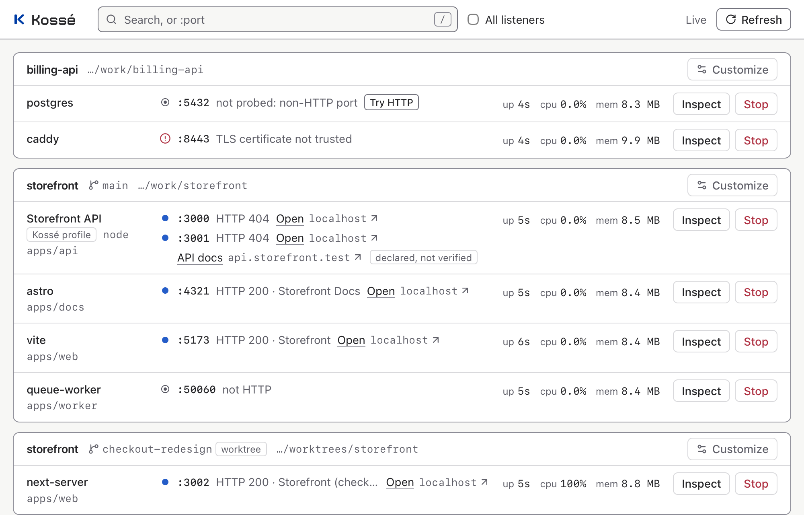

<h1>
  <picture>
    <source media="(prefers-color-scheme: dark)" srcset="brand/kosse-lockup-night.svg">
    
  </picture>
</h1>

A native macOS tray menu and a lightweight local dashboard for the development services you already run: **discover, identify, open, inspect, stop.**

You start dev servers from terminals, scripts and coding agents. A day later there are a dozen listeners on unremembered ports, some from worktrees you forgot. Kossé shows them grouped by repository, worktree and package, with honest observations (listening, reachable over HTTP, or neither) and current CPU and memory. It stops a forgotten process only after confirming its exact identity. It never asks you to register projects or change how you launch them.

<picture>
  <source media="(prefers-color-scheme: dark)" srcset="docs/screenshots/dashboard-dark.png">
  
</picture>

<sub>Fixture processes from the browser suite (`bun run screenshots`).</sub>

> **Status: v0.1.1, macOS on Apple silicon, unsigned** ([releases](https://github.com/davidpp/kosse/releases)). Verified from the installed binary ([audit](docs/evidence/S10.md)). Two checks need a person at a desktop and are **pending**: the native tray and window checklist ([S08](docs/evidence/S08.md#human-checklist)) and a real login cycle with `kosse startup enable` ([S09](docs/evidence/S09.md#unverified-deferred-approval-gates)).

## What it does

- **Discovers** every TCP listener on the Mac and the process behind it (PID, start time, user, redacted command line, working directory, CPU, memory), checked against `lsof`.
- **Identifies** the repository, worktree, branch and package each one runs in, from the process's working directory. Two checkouts of the same repository stay separate.
- **Observes** loopback HTTP endpoints of your own project processes with one bounded `GET` every 15 s, and reports what it saw (200, 404, a TLS failure, not HTTP) instead of a health verdict. Open appears only for endpoints that answered HTTP.
- **Stops** one process safely: SIGTERM after re-checking its exact identity and confirming every port it holds, then reports whether it exited, is still running (force is then offered, with a second confirmation), was respawned by its parent, or someone else took the port.
- **Three views on one scanner:** a native menu-bar menu, a dashboard in its own small window or any browser, and `kosse list` in the terminal.

## What it doesn't do

- Start, restart, wrap or supervise anything; allocate ports; proxy or provision certificates.
- Kill process groups or parents, escalate on its own, or clean up "stale" services automatically.
- Write into your repositories, phone home, check for updates, or load remote assets.
- Map container-internal services to repositories, keep metric history, or run on Linux or Windows (v1 is macOS arm64 only).

## Install

Kossé is one self-contained executable with the dashboard built in; it needs no Bun or Node at runtime. It is **not signed or notarized** (Apple silicon's mandatory signature is the linker's ad-hoc one). A binary fetched with `curl` and extracted with `tar` carries no quarantine attribute, so it runs as is; a browser download is quarantined and macOS refuses to open it.

- **From GitHub Releases** (recommended). The installer downloads the latest [release](https://github.com/davidpp/kosse/releases) with `curl`, refuses it unless its SHA-256 matches, verifies its build provenance when an authenticated [`gh`](https://cli.github.com) is available, and installs `~/.local/bin/kosse`:

  ```sh
  curl -fsSL https://github.com/davidpp/kosse/releases/latest/download/install.sh | sh
  # a given version or prefix: … | sh -s -- --version <version> --prefix <dir>
  ```

  Or by hand, with the archive and its `.sha256` from the release page:

  ```sh
  shasum -a 256 -c kosse-<version>-aarch64-apple-darwin.tar.gz.sha256
  gh attestation verify kosse-<version>-aarch64-apple-darwin.tar.gz --repo davidpp/kosse  # optional: built by this repository's release workflow
  tar -xzf kosse-<version>-aarch64-apple-darwin.tar.gz
  mkdir -p ~/.local/bin && install -m 0755 kosse-<version>-aarch64-apple-darwin/kosse ~/.local/bin/
  ```

  Then `kosse` starts the menu-bar app; `kosse startup enable` starts it at each login. Upgrading is the same command; quit the running Kossé and start it again.

- **Local release from source** (with the [development setup](#development)):

  ```sh
  bun run release:local    # artifacts/kosse-<version>-aarch64-apple-darwin.tar.gz + .sha256 + notices + manifest
  bun run install:local    # verifies it, installs ~/.local/bin/kosse (--prefix <dir> elsewhere)
  bun run uninstall:local  # removes exactly what it installed; keeps your configuration unless --purge
  ```

  Only for an archive whose origin and checksum you trust, `xattr -d com.apple.quarantine kosse` lifts Gatekeeper's check after a browser download.

- **Homebrew (no public tap yet).** Each release attaches `kosse.rb`, a formula for exactly that release's archive (from [`packaging/homebrew/kosse.rb.tmpl`](packaging/homebrew/kosse.rb.tmpl)). To use it: `brew tap-new <you>/kosse`, copy `kosse.rb` into that tap's `Formula/`, then `brew install <you>/kosse/kosse`.

If `~/.local/bin` is not on your `PATH` (it is not on a stock Mac): `echo 'export PATH="$HOME/.local/bin:$PATH"' >> ~/.zprofile`, then open a new terminal. `kosse doctor` checks the setup.

## Usage

| Command                                                   | What it does                                                                                                                                                                                                                                                                                                                                                                                                                                                   |
| --------------------------------------------------------- | -------------------------------------------------------------------------------------------------------------------------------------------------------------------------------------------------------------------------------------------------------------------------------------------------------------------------------------------------------------------------------------------------------------------------------------------------------------- |
| `kosse`                                                   | The menu-bar app: tray menu plus the dashboard at `http://127.0.0.1:47831/`, opening its window (`--no-open` to skip). A second `kosse` brings the running app's window forward instead of starting another.                                                                                                                                                                                                                                                   |
| `kosse open`                                              | The dashboard window without anything resident: serves until you close the window, then exits. With the menu-bar app running it shows that app's window.                                                                                                                                                                                                                                                                                                       |
| `kosse serve`                                             | Headless dashboard and API in the foreground (no tray), for any browser.                                                                                                                                                                                                                                                                                                                                                                                       |
| `kosse list [--json]`                                     | One Markdown table row per listening port (project, branch, configured service, port, HTTP state, process, `PID.START`, age), then configured services nothing matches. `--here` (this worktree), `--project <dir>`, `--port <n>` and `--service <name>` narrow it. Uses the running instance's snapshot when there is one, otherwise scans once. `--json` prints the `Snapshot` contract.                                                                     |
| `kosse url <service\|port>`                               | Prints only `http(s)://localhost:<port>/` of the service that answered HTTP (`curl "$(kosse url web --here)health"`); exits 1 with the probe state otherwise.                                                                                                                                                                                                                                                                                                  |
| `kosse port <n>`                                          | `free` (as far as this user can see) or the owning process, project and service.                                                                                                                                                                                                                                                                                                                                                                               |
| `kosse stop <pid>.<start> --ports <p,…>`                  | Stops one process through the running instance (`kosse serve` or the menu-bar app), as the dashboard's Stop does: the identity and every port it listens on (from `kosse list`) are the confirmation. Given a service name, port or PID, or a stale identity or port set, it signals nothing and prints the exact command that would confirm what runs now. `kosse force` (same arguments) sends `SIGKILL` only within the offer a still-running stop printed. |
| `kosse doctor [--json]`                                   | Checks platform, binary and `PATH`, configuration, who holds the port, `git`, login startup. Changes nothing.                                                                                                                                                                                                                                                                                                                                                  |
| `kosse startup enable\|disable\|status`                   | Opt-in login startup: a per-user LaunchAgent running this `kosse --no-open` at each login (no `KeepAlive`, so Quit stays quit). Off until enabled.                                                                                                                                                                                                                                                                                                             |
| `kosse config schema\|path\|move`                         | The `kosse.json` JSON Schema, the configuration file's location, and re-attaching a profile after moving a project.                                                                                                                                                                                                                                                                                                                                            |
| `kosse profile context\|show\|set\|remove\|check\|prompt` | For the coding agent in a repository: what Kossé observes there, the stored and effective profile, a validated `set --dry-run` preview, and writes to Kossé's own configuration only (`--expect <revision>` guards against a concurrent change). `prompt` prints the text to paste into the agent. Markdown by default, `--json` for tooling.                                                                                                                  |

**Tray menu:** projects with their branch; each service as `name :port` with Open (only if it answered HTTP), Inspect and Stop… (both open the dashboard window at that service; Stop… is the dashboard's own confirmation); Open Dashboard; Quit Kossé. Quit stops Kossé only, never the services it shows. The icon switches to its attention variant only when discovery fails or stalls.

Agent commands (`list`, `url`, `port`, `profile`, `stop`, `force`) exit 0 with an answer, 1 for a negative answer (for `stop`: still running, respawned or port taken), 2 on a usage error (including `--here` outside a project), 3 when refused and 4 when nothing could be observed; with `--json`, failures are a `CommandError` on stderr. Every flag and route is documented in [CONTRIBUTING.md](CONTRIBUTING.md#running-the-binary). Optional project names and links live in a central profile ("Customize this project" in the dashboard) or a read-only `kosse.json` in the repository ([schema](docs/kosse.schema.json), [format](blueprint/project-metadata.md)).

## Architecture

```text
            ┌──────────── kosse (one process per port) ────────────┐
 tray menu ─┤  scanner thread ──► snapshot ──► Axum API + SSE      ├── dashboard (WKWebView child
 (main      │  (sockets, sysinfo,   ▲          (127.0.0.1 only,    │    `kosse window`, or any browser)
  thread)   │   git, profiles)      │           Host/Origin/token) │
            │  bounded loopback HTTP probes      embedded SPA      ├── kosse list / url / port / doctor
            └──────────────────────────────────────────────────────┘
crates/core  discovery · identity · attribution · action policy · profiles (no UI or server deps)
crates/app   CLI · scheduler · prober · API · tray · window
web/         TanStack Redact + Query dashboard, ≤ 50 kB gzipped JS + CSS, embedded in the binary
```

Every view reads the same snapshot and uses the same action policy; there is no second scanner or alternate destructive path. Rust contract types generate the TypeScript the UI consumes, and CI fails on drift. Details: [architecture](blueprint/architecture.md), [product contract](blueprint/product.md), [verification gates](blueprint/verification.md).

Measured on an M4 Pro with the installed binary ([S10](docs/evidence/S10.md#matrix)): the idle menu-bar app with its window closed uses about 0.1 % CPU and 12 MB of private memory; an open window adds about 66 MB across its WebKit processes ([S08](docs/evidence/S08.md#measurements-footprint-gate)) and closing it gives that back.

## Security model

Kossé binds to loopback only and treats every website, repository file and process-derived string as untrusted: `Host` is checked on every route, cross-origin API requests are refused, mutations need the same-origin `Origin`, JSON, a bounded body and a per-instance token, there are no CORS headers, and a strict CSP applies to every response. Stop requires a fresh identity and explicit confirmation; other users' processes and Kossé itself are never signalled or probed. Command lines are redacted before they leave the core. The threat model and its limits (heuristic redaction, the PID-reuse window, same-user malware) are in [SECURITY.md](SECURITY.md).

## Development

Requires macOS on Apple silicon, the Xcode Command Line Tools and [mise](https://mise.jdx.dev); every tool version is pinned in the repository.

```sh
mise trust && mise install
bun install --frozen-lockfile
bun run check      # the full non-mutating gate, identical to CI
bun run dev        # backend + Vite on http://127.0.0.1:47833/
bun run test:e2e   # Playwright (WebKit + Chromium) against the real server and owned fixtures
bun run app -- start   # the real menu-bar app + window on fixtures (docs/agent-drive.md)
bun run test:window    # real WKWebView window suite (transparent, click-through window)
bun run build && target/release/kosse
```

Tests run against real things: owned fixture processes checked against `lsof`, the real HTTP server, real browsers, the packaged archive in a sandbox. They never signal, probe or reconfigure anything they did not start. See [CONTRIBUTING.md](CONTRIBUTING.md) for every command and convention, and [AGENTS.md](AGENTS.md) for the rules coding agents follow here.

## Limitations

- macOS on Apple silicon only; no signed, notarized or published build.
- Redaction is heuristic: a bare positional secret without a recognisable key or shape is shown.
- Other users' sockets are invisible without administrator rights (reported as a snapshot warning); Kossé never asks for them.
- CPU needs two observations: a fresh process reads "warming up" for one scan, and `kosse list` (one shot) always does.
- macOS 14+ activation is cooperative: a window brought forward from a terminal command may stay behind the terminal.
- Without the Xcode Command Line Tools, Git worktrees are not attributed (reported, never guessed).
- No metric history, container attribution or terminal UI yet; the OpenTUI client (`kosse tui`) is the next phase.

## How this project is built

Kossé is developed blueprint-first. [`blueprint/`](blueprint/README.md) holds the product contract, architecture, verification gates and a dependency-ordered [slice plan](blueprint/implementation-plan.md). Each slice was implemented and verified through real entrypoints, recorded in [`docs/evidence/`](docs/evidence/) (commands, results, measurements and what stayed unverified), then reviewed by independent lenses (correctness and security, documentation and product) before it landed. Mocked tests alone never count as done, and human-only checks are never marked passed by an agent. The release history is in [CHANGELOG.md](CHANGELOG.md).

## License

[MIT](LICENSE). Kossé is an independently written project; see [provenance notes](blueprint/references.md#inspiration-and-boundaries). Third-party licenses ship in the archive's `THIRD_PARTY_NOTICES.md`.

## Brand

_Kossé ?_ is Québécois for "what's that?", the question you ask about an unfamiliar port. The **Relay** mark is a separated K, with dedicated optical geometry for the menu bar; its colour is a Québec-inspired blue (#003DA5), and the wordmark is set in Kibernetyk Mono SemiBold and shipped only as outlines. The identity, palette and tokens are in [`brand/BRAND.md`](brand/BRAND.md); the assets and how to regenerate them are in [`brand/`](brand/README.md).
